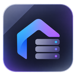
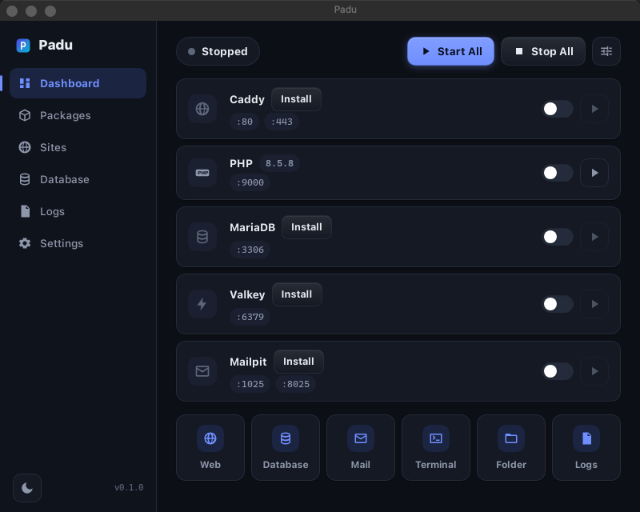

<p align="center">
  
</p>

<h1 align="center">Padu</h1>

<p align="center">
  Tumpukan pengembangan lokal yang ringan dan bersahabat: server web, PHP, database, cache, dan penangkap email dalam satu jendela.<br>
  Beberapa klik, dan <code>https://aplikasi-saya.test</code> berjalan di komputer Anda sendiri.
</p>

<p align="center">
  <a href="#pemasangan">Pemasangan</a> ·
  <a href="#apa-yang-anda-dapat">Apa yang Anda dapat</a> ·
  <a href="#lima-menit-pertama">Lima menit pertama</a> ·
  <a href="README.md">English</a>
</p>

---

Padu untuk siapa saja yang membangun untuk web dan ingin perlengkapan lokalnya langsung jalan.
Ia melayani situs HTML dan JavaScript biasa, aplikasi PHP (WordPress, Laravel, Symfony, dan
kawan-kawan), serta memberi proyek apa pun database lokal, cache, penangkap email, dan Node.js.
Anda hanya memilih bagian yang dibutuhkan; tidak ada yang dipaksakan, dan tidak ada yang
berjalan tanpa Anda nyalakan.



## Apa yang Anda dapat

- **Semua yang biasa dibutuhkan, tanpa yang tidak perlu.** PHP (8.1 sampai 8.5 terbaru), server
  web (bawaan Caddy, atau Nginx/Apache), MariaDB atau MySQL, Valkey/Redis, Mailpit untuk
  menangkap email keluar, Node.js, Composer, Adminer, dan phpMyAdmin. Semuanya opsional dan
  versinya Anda pilih dari daftar. Beberapa versi bisa terpasang berdampingan.
- **Folder menjadi situs.** Taruh folder proyek di `www/`, maka ia dilayani di
  `https://nama-folder.test` dengan sertifikat yang dipercaya browser. Berlaku untuk situs
  statis, aplikasi PHP, dan apa pun yang punya `index.html` atau `index.php`; folder `public/`
  Laravel dan Symfony dikenali otomatis.
- **Tidak perlu menebak.** Setiap layanan menampilkan status, port, dan versi. Unduhan punya
  bilah kemajuan. Tab Log menunjukkan apa yang salah, dengan warna.
- **Ringan.** Aplikasinya sekitar 9 MB. Runtime diunduh dari server resminya hanya saat Anda
  minta, diverifikasi dengan checksum, dan bisa dihapus per versi.
- **Aman sejak awal.** Semua layanan hanya mendengarkan di localhost. Database mendapat kata
  sandi root acak saat pertama dijalankan. HTTPS memakai otoritas sertifikat lokal yang tidak
  pernah keluar dari komputer Anda. Tanpa akun, tanpa telemetri.
- **Selalu mutakhir.** Padu memberi tahu saat rilis baru terbit dan memperbarui dirinya dengan
  satu klik (atau otomatis, kalau Anda mau). Daftar paket selalu tahu PHP, MariaDB, dan lainnya
  yang terbaru.
- **Linux, Windows, dan macOS**, mode gelap dan terang.

## Pemasangan

Unduh berkas untuk sistem Anda dari **[rilis terbaru](../../releases/latest)**.

### Linux

**Debian, Ubuntu, Kubuntu, Linux Mint, Pop!_OS** (`.deb`):
```sh
sudo apt install ./Padu_0.1.1_amd64.deb
```
Padu muncul di menu aplikasi. Pembaruan: Padu menampilkan pemberitahuan dan membuka halaman
rilis; unduh `.deb` baru lalu jalankan perintah yang sama.

**Fedora, openSUSE, RHEL** (`.rpm`):
```sh
sudo dnf install ./Padu-0.1.1-1.x86_64.rpm     # atau: sudo zypper install ./Padu-*.rpm
```

**Distribusi apa pun** (`.AppImage`, tanpa pemasangan):
```sh
chmod +x Padu_0.1.1_amd64.AppImage
./Padu_0.1.1_amd64.AppImage
```
AppImage bisa memperbarui dirinya dari dalam aplikasi. Pindahkan ke folder seperti
`~/Applications` agar rapi.

Port 80 dan 443 di Linux butuh izin satu kali: tekan **Start All** di Padu lalu ikuti
petunjuknya, atau jalankan `padu doctor --fix-ports` dari CLI. Bisa juga memakai 8080/8443 di
Settings.

### Windows 10 / 11

1. Unduh `Padu_0.1.1_x64-setup.exe` lalu jalankan. Jika SmartScreen berkata "Windows protected
   your PC", klik **More info → Run anyway** (pemasangnya masih baru dan belum banyak diunduh;
   hanya itu arti peringatannya).
2. Ikuti pemasangnya. Padu ditambahkan ke menu Start. Runtime Microsoft WebView2 dipasang
   otomatis jika komputer Anda belum punya.
3. Perlu MSI untuk pemasangan di perusahaan? `Padu_0.1.1_x64_en-US.msi` ada di rilis yang sama.

Pembaruan dipasang langsung dari dalam aplikasi.

### macOS (Apple Silicon dan Intel)

1. Unduh `Padu_0.1.1_universal.dmg`, buka, lalu seret **Padu** ke **Applications**.
2. Peluncuran pertama: klik kanan (atau Control-klik) Padu → **Open** → **Open**. macOS bertanya
   sekali karena aplikasi belum ditandatangani sertifikat Apple Developer.
3. Pembaruan dipasang langsung dari dalam aplikasi.

### Baris perintah (opsional)

Setiap rilis juga menyertakan alat baris perintah `padu` dengan fitur yang sama:

```sh
# Linux / macOS
chmod +x padu-cli-linux-x86_64 && sudo mv padu-cli-linux-x86_64 /usr/local/bin/padu
# Windows (PowerShell): pindahkan padu-cli-windows-x86_64.exe ke folder yang ada di PATH, ganti nama menjadi padu.exe

padu init && padu install php && padu install caddy && padu start
```

### Di mana semuanya disimpan

Peluncuran pertama membuat folder `padu` di direktori home Anda (`~/padu`, atau
`C:\Users\anda\padu`) untuk proyek (`www/`), pengaturan, runtime yang diunduh, database, dan log.
Tidak ada bagian lain dari sistem yang disentuh. Mencopot aplikasi tetap menyisakan folder itu
untuk Anda.

## Lima menit pertama

1. Buka Padu → **Packages** → pasang PHP, Caddy, dan MariaDB (serta Mailpit jika mengirim email).
2. **Settings → Trust local CA** supaya `https://*.test` menampilkan gembok di browser.
3. **Dashboard → Start All**. Saat Padu meminta memperbarui berkas hosts, izinkan; itu yang
   membuat `aplikasi-saya.test` mengarah ke komputer Anda.
4. **Sites → New project**: WordPress, Laravel, Symfony, templat Composer apa pun, URL git, atau
   folder kosong. Database dengan nama yang sama dibuatkan untuk Anda.
5. Buka `https://aplikasi-saya.test`. Untuk situs HTML atau JavaScript biasa, cukup taruh
   foldernya di `www/` lalu tekan **Sync** di Sites.

Masuk ke database: host `127.0.0.1`, pengguna `root`, kata sandi di **Database → Show**.

## Cara kerjanya

Padu ditulis dengan Rust dan antarmuka web kecil (Tauri 2) yang memakai web view bawaan sistem
operasi, jadi tidak ada browser yang dibundel. Ia menulis konfigurasi yang diperketat untuk
server yang dikelolanya, mengawasi prosesnya, dan menyunting berkas hosts lewat pembantu kecil
yang hanya menyentuh baris miliknya. Rincian: [docs/ARCHITECTURE.md](docs/ARCHITECTURE.md),
[docs/SECURITY.md](docs/SECURITY.md). Membangun dari sumber: [docs/BUILD.md](docs/BUILD.md).

## Lisensi

Padu gratis dan sumber terbuka di bawah [Lisensi MIT](LICENSE). Ini implementasi orisinal tanpa
kode, templat, atau aset dari produk serupa lain; nama produk lain dalam dokumen ini milik
pemiliknya masing-masing. Dependensi Rust dan lisensinya tercantum di
[THIRD_PARTY_NOTICES.md](THIRD_PARTY_NOTICES.md). Runtime diunduh dari server resminya atas
permintaan Anda dan tidak didistribusikan ulang di sini.
