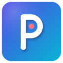
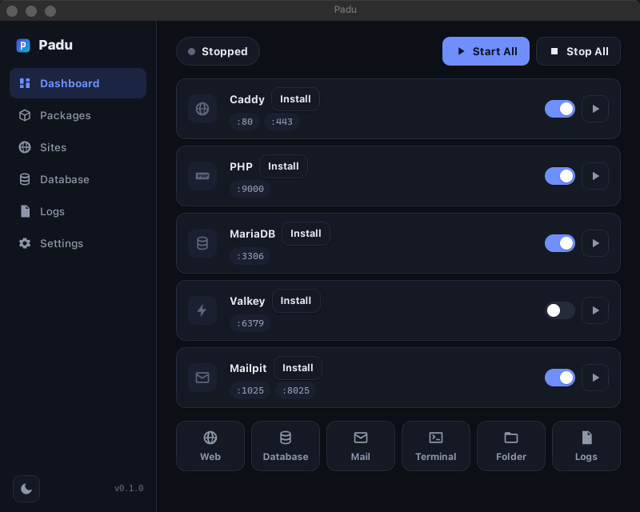

  

<h1 align="center">Padu</h1>

  A small, friendly local web server for PHP projects. 
  One window, a few clicks, and <code>https://my-app.test</code> is running on your own machine.

  <a href="#download">Download</a> ·
  <a href="#what-you-get">What you get</a> ·
  <a href="#how-it-works">How it works</a> ·
  <a href="README.id.md">Bahasa Indonesia</a>

---

Padu is for people who build websites with PHP and just want the usual stack running locally
without a weekend of setup. Think of it as the quiet alternative to the big "all-in-one" bundles:
it starts fast, stays out of your way, and only downloads the pieces you actually use.

## What you get

- **The whole stack, picked by you.** PHP (8.1 up to the newest 8.5), a web server (Caddy by
  default, Nginx or Apache if you prefer), MariaDB or MySQL, Valkey/Redis, Mailpit for catching
  emails, plus Node.js, Composer, Adminer and phpMyAdmin. Choose the version you want from a list,
  switch later, keep several side by side.
- **Projects become websites by themselves.** Drop a folder into `www/` and it is served at
  `https://folder-name.test` with a certificate your browser trusts. Laravel and Symfony's
  `public/` folders are picked up automatically.
- **Honest about what it is doing.** Every service shows its state, port and version. Downloads
  have a real progress bar. There is a Logs tab when something goes wrong, so you never have to
  guess.
- **Light on your computer.** The app itself is about 9 MB. Nothing is bundled; runtimes come
  from their official download servers, verified with checksums, only when you ask for them.
- **Safe defaults.** Everything listens on localhost only. The database gets a random root
  password on first start instead of an empty one. HTTPS uses a local certificate authority that
  never leaves your machine. No accounts, no tracking, no background network traffic.
- **Keeps itself fresh.** Padu tells you when a new version is out and installs it with one click
  (or on its own, if you turn that on). The package list always knows the newest PHP, MariaDB and
  friends.
- **Works the same on Linux, Windows and macOS.** Dark and light mode included.

## Download

Grab the installer for your system from the **[Releases](../../releases/latest)** page:

| System | File | Notes |
|---|---|---|
| Linux (Debian, Ubuntu, Kubuntu, Mint) | `padu_x.y.z_amd64.deb` | `sudo apt install ./padu_x.y.z_amd64.deb` |
| Linux (any) | `padu_x.y.z_amd64.AppImage` | make it executable and run; this one updates itself |
| Linux (Fedora, openSUSE) | `padu-x.y.z-1.x86_64.rpm` | `sudo dnf install ./padu-*.rpm` |
| Windows 10/11 | `Padu_x.y.z_x64-setup.exe` | normal installer; WebView2 is fetched if missing |
| macOS | `Padu_x.y.z_universal.dmg` | Apple Silicon and Intel in one file |

The first launch creates a `padu` folder in your home directory for projects, settings and
databases. Nothing else on your system is touched.

Prefer a terminal? There is a `padu` command-line tool in the same release with every feature of
the app (`padu install php`, `padu start`, `padu project create blog --template wordpress`).

## First five minutes

1. Open Padu, go to **Packages**, install PHP, Caddy and MariaDB (Mailpit is handy too).
2. In **Settings** press **Trust local CA** so `https://*.test` shows a padlock in your browser.
3. Back on the **Dashboard** press **Start All**. When Padu asks to update your hosts file, say yes;
   that is what makes `my-app.test` resolve.
4. **Sites → New project**: pick WordPress, Laravel, Symfony, a Composer template or a git URL. A
   database with the same name is created for you.
5. Open `https://my-app.test`. Done.

Database login: host `127.0.0.1`, user `root`, password in **Database → Show**.

## How it works

Padu is written in Rust with a tiny web-based interface (Tauri 2, using the web view your system
already has, so there is no bundled browser). It generates hardened configuration for the servers
it runs, supervises their processes, and manages the hosts file through a small helper that only
touches the lines it owns. The details live in [docs/ARCHITECTURE.md](docs/ARCHITECTURE.md) and
the security notes in [docs/SECURITY.md](docs/SECURITY.md).

Building from source, releasing and the auto-update setup are described in
[docs/BUILD.md](docs/BUILD.md).

## Good to know

- Linux: ports 80 and 443 need a one-time permission (`padu doctor --fix-ports`) or you can use
  8080/8443 in Settings.
- Linux `.deb`/`.rpm` installs do not update in place; the app opens the release page instead.
  The AppImage does update itself.
- macOS is not signed with an Apple Developer certificate yet, so the first launch shows the usual
  "unidentified developer" prompt (right-click → Open).

## Legal

Padu is an original, clean-room implementation. It contains no code, templates, assets or text
from other local-stack products; other product names in these docs belong to their owners and
are only used to identify them. All Rust dependencies are permissively licensed (see
[THIRD_PARTY_NOTICES.md](THIRD_PARTY_NOTICES.md)). Runtimes are downloaded from their official
servers at your request and are not redistributed here.

Private project. See [LICENSE](LICENSE).
